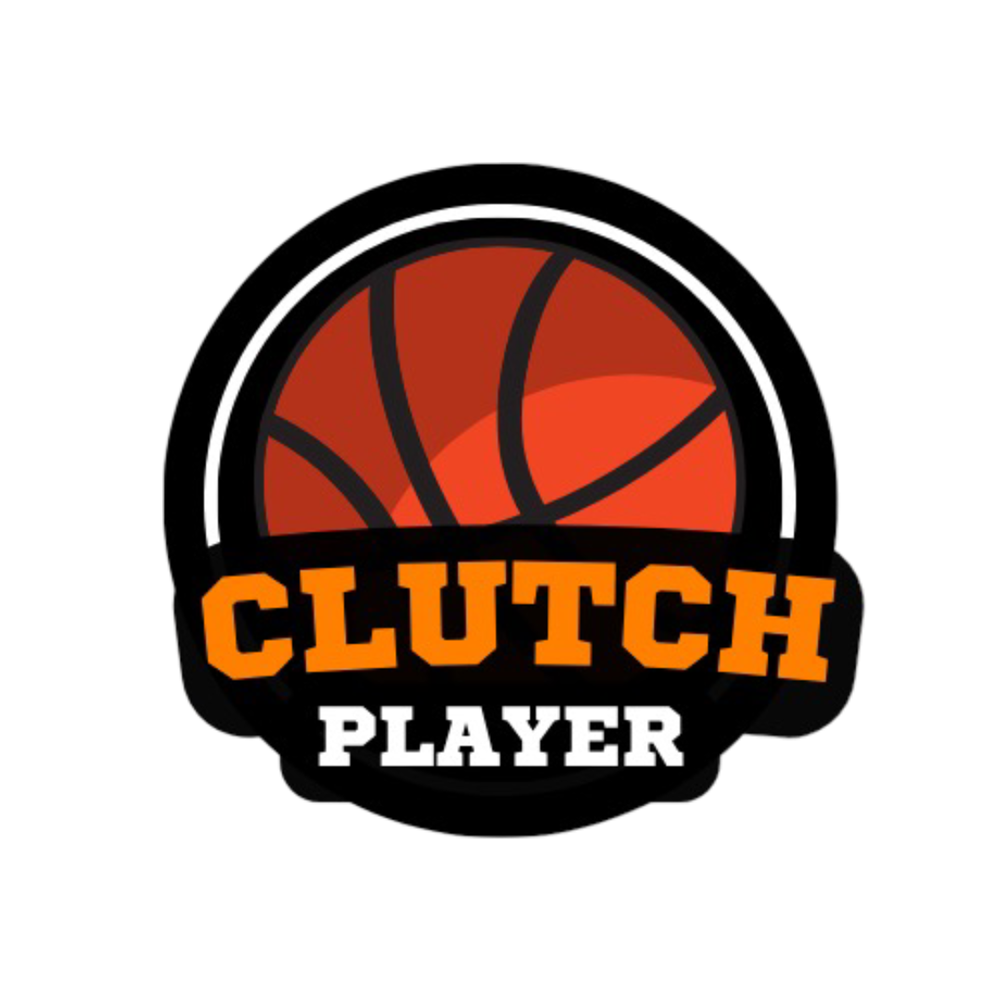
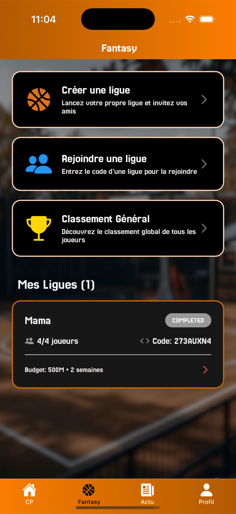
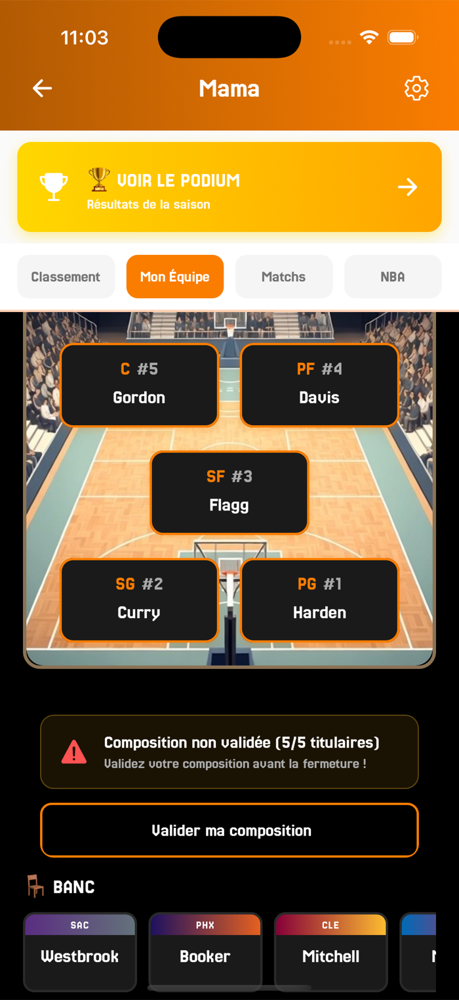
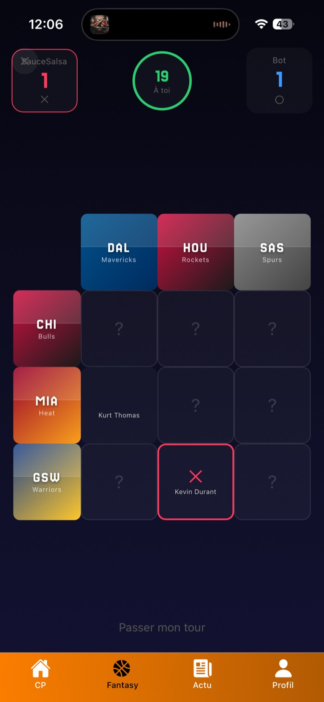
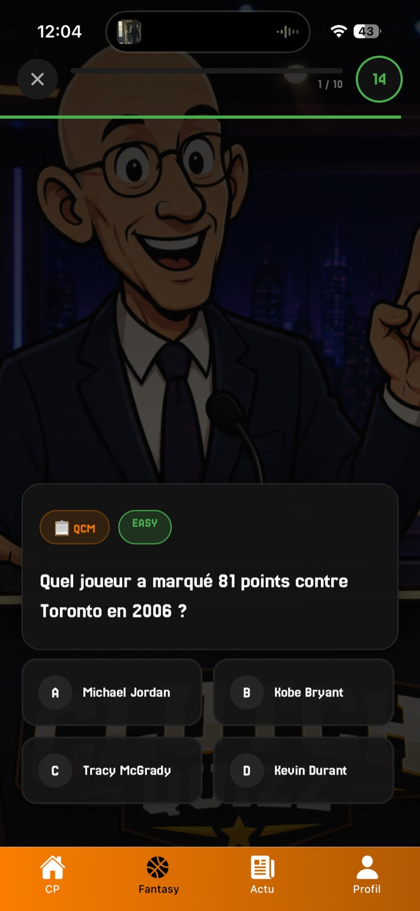
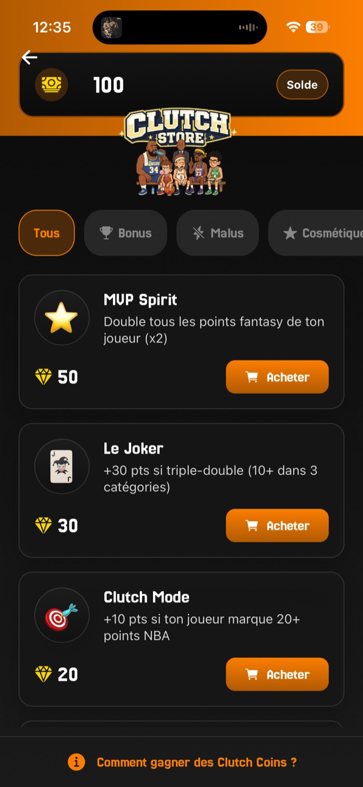
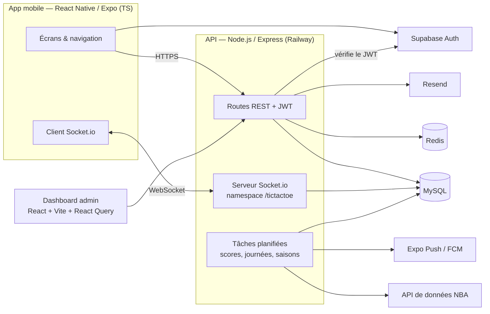

  

<h1 align="center">Clutch Player</h1>

  Application mobile de fantasy basket NBA — iOS & Android 
  <a href="https://clutchplayer.xyz">clutchplayer.xyz</a>

  
  
  
  
  
  
  

> Le code source est privé (application en production). Ce dépôt présente le projet, son architecture et les choix techniques. Je peux le montrer en détail lors d'un entretien.

---

## Le projet

Clutch Player est une application de fantasy NBA que je conçois, développe et maintiens seul, du design jusqu'à la mise en production sur les stores.

| Mode | Principe |
|---|---|
| **Ligues privées** | Draft aux enchères avec budget entre amis (4 à 10 managers, 15 joueurs par équipe), composition de 5 titulaires, bonus/malus, duels sur des journées de 2 nuits NBA |
| **Clutch Killer** | Défi quotidien public : 5 joueurs par soir, points selon leurs stats réelles, classement de saison |
| **Buzzer Game** | Pronostic du vainqueur de chaque match NBA, verrouillé au coup d'envoi |
| **Tic Tac Toe NBA** | Multijoueur temps réel : trouver un joueur qui valide deux critères (équipe, saison, award…) |
| **NBA Chain** | Enchaîner des coéquipiers le plus loin possible, contre la montre |
| **Clutch Quizz** | 10 questions NBA par jour, 5 types d'épreuves |

Autour : badges, classements, boutique en monnaie virtuelle gratuite, notifications push, fil d'actualité, parrainage.

## Captures

  
  
  
  
  

## Architecture

**En chiffres** : ~48 000 lignes TypeScript côté mobile, ~43 000 lignes côté API, 37 fichiers de routes, 300+ endpoints, une dizaine de tâches planifiées.

## Points techniques

**Temps réel**
- Tic Tac Toe migré d'un polling REST vers **Socket.io** : matchmaking en mémoire, salles par partie, **timer de tour géré côté serveur** et diffusé aux deux joueurs (pas de triche possible côté client), reconnexion.

**Traitement de données**
- Synchronisation quotidienne des matchs et stats NBA depuis une API externe, avec cache Redis.
- Calcul automatique des scores fantasy de toutes les ligues après chaque nuit NBA (tâches cron), classements recalculés avec des fonctions de fenêtre SQL (`RANK()`).
- Planificateur qui crée les journées de chaque ligue selon le calendrier NBA réel.

**Sécurité & conformité**
- Authentification Supabase (email, Apple, Google), JWT vérifié par middleware sur chaque route protégée, tokens stockés dans le stockage sécurisé du téléphone.
- Verrouillage des choix revérifié côté serveur (heure de début des matchs), jamais seulement côté client.
- Suppression de compte RGPD dans une transaction SQL unique (toutes les tables liées, rollback en cas d'erreur).
- Consentement publicitaire UE (Google UMP), politique de confidentialité, déclarations App Store (privacy manifest).

**Mise en production**
- Builds EAS iOS/Android, **mises à jour OTA** (expo-updates) pour corriger sans repasser par les stores.
- Gestion du cycle de review Apple (retours sur les guidelines, nettoyage du code mort, permissions minimales).
- Notifications push (fin de draft, résultats, badges), emails transactionnels et campagnes via Resend.
- Dashboard admin pour piloter les saisons, les questions du quiz, les emails et les données NBA.

## Stack

| Couche | Technologies |
|---|---|
| Mobile | React Native 0.85, Expo SDK 56, TypeScript, React Navigation 7, Reanimated, expo-updates, i18n FR/EN |
| API | Node.js (ES Modules), Express, Socket.io, node-cron, mysql2, Redis |
| Données | MySQL, Redis |
| Auth | Supabase Auth (email, Apple Sign In, Google) |
| Admin | React 19, Vite, TanStack React Query, Axios |
| Infra | Railway (API + BDD), EAS Build / Update, Expo Push |
| Services | Resend (emails), Google AdMob |

## Développement assisté par IA

Je travaille au quotidien avec **Claude Code** : prototypage d'écrans, refactors, revue de code, audit avant soumission App Store, analyse de bugs en production. Je garde la main sur l'architecture et je relis tout ce qui part en production.

---

Justin Mesnil — <a href="https://github.com/Juwwju">github.com/Juwwju</a>

